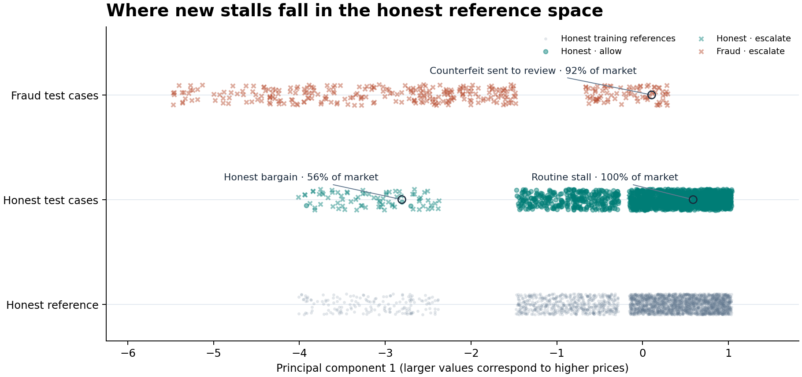

# NANDA Market Supervisor

A [HALHack pilot](https://nandahack.projectnanda.org/hackathons/halhack-pilot-nov-20-2026) project for NANDA Market. The Supervisor learns what honest stalls look like, sends unusual listings to a human watcher, and moves cases with corroborated evidence up the inbox. The watcher sees the clue and chooses Allow or Block.

## Run it locally

Install Python 3.10+ and [Lune 0.11.0](https://github.com/lune-org/lune/releases/tag/v0.11.0). From the root of this checkout, run:

```sh
bash harness/starter/supervisor/demo.sh
```

The launcher creates a Python virtual environment, trains the monitor, and runs the paired headless matches through the real local gateway. It uses an automated watcher at the same capacity in each match. The demo requires no API keys or Roblox Studio. If Lune is installed outside `PATH`, use `LUNE=/path/to/lune bash harness/starter/supervisor/demo.sh`.

See the [monitor and Studio setup](harness/starter/supervisor/README.md) to try it with a human watcher in the game.

## What we found

In four paired five-minute headless matches, moving evidence-backed cases up the inbox helped the same simulated watcher act before more deadlines.

| Outcome | Deadline order | Evidence priority |
| --- | ---: | ---: |
| Fraud escapes | 114 | 82 |
| Cases expired in the inbox | 156 | 131 |
| Honest stalls blocked | 6 | 2 |

On two stress-test seeds, hiding a cue raised fraud escapes from 66 to 75. Making some honest counters look empty raised escapes to 67. The learned cues reflect how this simulator represents fraud. The Roblox place built successfully with Rojo. Visual behavior in Roblox Studio remains unverified.

[Detailed replay and match results](docs/supervisor/results.json) · [Demo plot](docs/supervisor/latent-space.png)



## Credits

Built on [Peter Danenberg’s nandablox](https://github.com/klutometis/nandablox/tree/af9606a), which supplies the Roblox market, simulator, and monitor gateway and builds on [Project NANDA’s NANDA Town](https://github.com/projnanda/nandatown). This submission adds the learned monitor, evidence labels and inbox prioritization, and the evaluation scripts.
